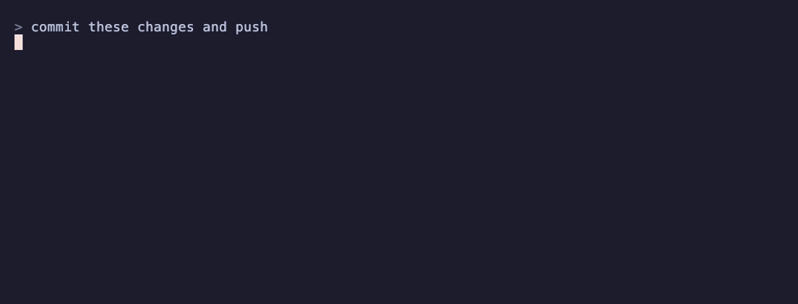

# claude-code-cookbook

> Tested, copy-pasteable recipes for Claude Code: hooks, slash commands, subagents, and settings.



## Why this exists

Most Claude Code config lists are link dumps. This one is different:

- **Tested** — every recipe runs in a real workflow before it lands here
- **Copy-pasteable** — clone, copy a folder, you're done
- **War stories** — each recipe opens with the pain it solves, not the config

## Browse by category

### Hooks

| Recipe | Pain it solves |
|---|---|
| [block-main-branch-commits](recipes/hooks/block-main-branch-commits) | Accidentally committing directly to main |
| [auto-format-on-edit](recipes/hooks/auto-format-on-edit) | Files drifting from your formatter's style |
| [notify-on-completion](recipes/hooks/notify-on-completion) | Watching a long Claude task instead of context-switching |
| [pre-push-ci-mirror](recipes/hooks/pre-push-ci-mirror) | CI catches what you could have caught locally in 5 seconds |

### Slash commands

| Recipe | Pain it solves |
|---|---|
| [ship-it](recipes/slash-commands/ship-it) | The 6-step PR ceremony, every time |
| [standup](recipes/slash-commands/standup) | "What did I do yesterday?" at 9am |
| [triage-deps](recipes/slash-commands/triage-deps) | The Dependabot PR backlog you keep avoiding |

### Subagents

| Recipe | Pain it solves |
|---|---|
| [rails-developer](recipes/subagents/rails-developer) | Generic Rails advice that ignores your app's conventions |
| [senior-architect](recipes/subagents/senior-architect) | One opinionated answer when you wanted options + trade-offs |
| [product-designer](recipes/subagents/product-designer) | UX advice that ignores your existing components and patterns |
| [code-reviewer](recipes/subagents/code-reviewer) | Review feedback with no severity, no priorities, occasionally invented |

### Settings

| Recipe | Pain it solves |
|---|---|
| [sensible-permissions-rails](recipes/settings/sensible-permissions-rails) | Permission prompts every 30 seconds (Rails) |
| [sensible-permissions-electron](recipes/settings/sensible-permissions-electron) | Permission prompts every 30 seconds (Electron / Node) |
| [cost-conscious-defaults](recipes/settings/cost-conscious-defaults) | Surprise API bills |

## Quickstart

Install a recipe in 30 seconds:

```bash
git clone https://github.com/vicmastter/claude-code-cookbook.git
cd claude-code-cookbook/recipes/hooks/block-main-branch-commits
# follow the README in that folder
```

Most recipes are 1–2 files dropped into `~/.claude/` or your project's `.claude/` directory.

## Contributing

Got a recipe that earned its keep? See [CONTRIBUTING.md](CONTRIBUTING.md). The bar is simple: it must follow the [template](recipes/_template), and you must have actually used it.

## Who built this

Built by [Victor Velazquez](https://github.com/vicmaster) — COO at [MagmaLabs](https://www.magmalabs.io), working on AI agent platforms. Follow me on [X](https://x.com/zazvick) and say hi! :wave:

## License

MIT — see [LICENSE](LICENSE).
